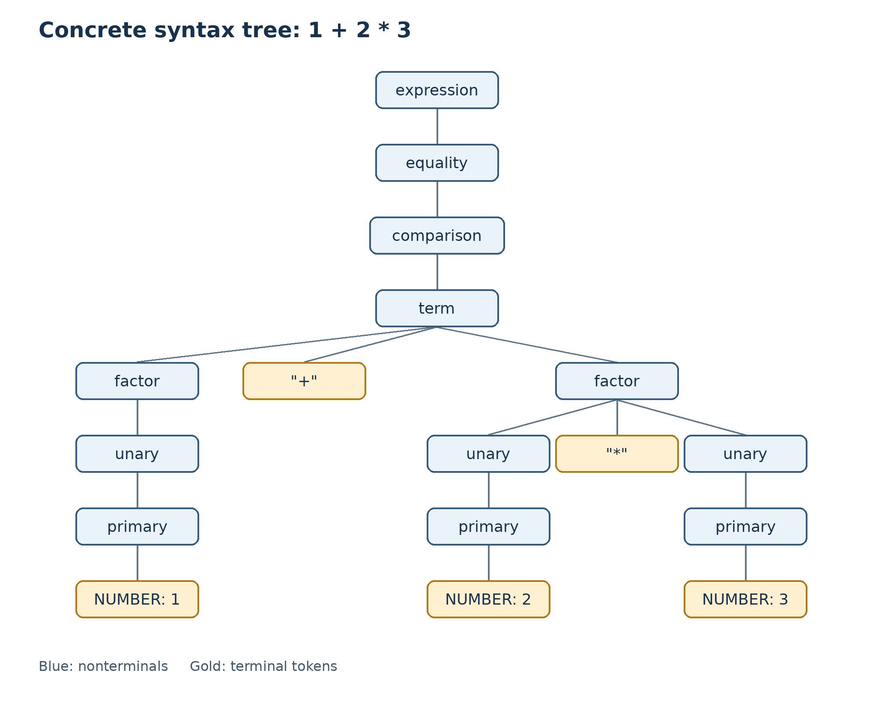

# Lab 3: Parser

Josh Bolter

CIS 343 - Structure of Programming Languages

## Language and scope

I continued JoshLang from Labs 1 and 2. The program now scans one expression, builds its abstract syntax tree, and prints that tree. It accepts a source file or interactive input. This lab does not evaluate expressions yet.

I kept Lox's expression operators and added `%` for remainder. Remainder has the same precedence as multiplication and division. Numbers, strings, `true`, `false`, and `nil` are the supported literal types. The scanner also recognizes identifiers and statement keywords, but those are reserved for later parts of the language.


## Expression grammar

I used the same expression grammar as Lab 2. There were no changes to its operators or expression forms. The main program now requires EOF after the expression so it cannot silently ignore extra tokens.

```text
expression → equality ;
equality   → comparison ( ( "!=" | "==" ) comparison )* ;
comparison → term ( ( ">" | ">=" | "<" | "<=" ) term )* ;
term       → factor ( ( "-" | "+" ) factor )* ;
factor     → unary ( ( "/" | "*" | "%" ) unary )* ;
unary      → ( "!" | "-" ) unary | primary ;
primary    → NUMBER | STRING | "true" | "false" | "nil"
           | "(" expression ")" ;
```

Lowercase names are nonterminals. Uppercase names are token categories, and quoted symbols are fixed tokens. `|` gives alternatives, and `*` means zero or more repetitions. This follows the notation used in the context-free grammar and parsing lectures.[1][2]

### Precedence and associativity

The rows below run from lowest to highest precedence.

| Level | Operators or expression form | Associativity |
| --- | --- | --- |
| Equality | `==`, `!=` | Left |
| Comparison | `>`, `>=`, `<`, `<=` | Left |
| Term | `+`, binary `-` | Left |
| Factor | `*`, `/`, `%` | Left |
| Unary | `!`, unary `-` | Right |
| Primary | Literals and parenthesized expressions | Not applicable |

For example, `1 + 2 * 3` becomes `(+ 1 (* 2 3))`, while `(1 + 2) * 3` becomes `(* (group (+ 1 2)) 3)`. Subtraction is left-associative, so `10 - 3 - 2` becomes `(- (- 10 3) 2)`.

The repeated sections in the grammar do not determine how an AST is nested by themselves. I build each binary node using the previous result as its left operand. That gives the left-associative structure described in the parsing lecture. Unary parsing calls itself for its operand, so `!!-2` becomes `(! (! (- 2)))`.[2]

## Implementation

`src/parser.py` contains the `Parser` class. The parser receives the scanner's token list and keeps an index for the next token. There is a method for each precedence level. The four binary levels share `_binary()` because they use the same loop with different operand rules and operators.

The parser reuses the four AST classes from Lab 2: `Literal`, `Unary`, `Binary`, and `Grouping`. It converts the `true`, `false`, and `nil` tokens into Python `True`, `False`, and `None` values. Numeric and string tokens already contain their literal values.

`src/main.py` connects the scanner, parser, and AST printer. A successful source-file run prints one AST and returns exit code `0`. Invalid source returns exit code `65`, writes diagnostics to stderr, and prints no AST to stdout. Interactive mode continues after an error and returns `0` when input ends.

### Error handling

The parser reports the line and column of the token where it detects a problem. Missing-operand messages identify the preceding operator. An unclosed-group message also identifies the opening parenthesis. Unexpected trailing tokens are reported after parsing a complete expression.

I stop at the first syntax error in an input. Since each input contains only one expression, there is no later statement to synchronize with. This matches the expression-only error handling described in the lecture.[2] The next interactive input starts with a fresh scanner and parser.

If scanning reports a lexical error, the main program does not run the parser. Excessive recursive nesting is also converted into a diagnostic instead of exposing a Python traceback.

## Setup and commands

Python 3.10 or newer is sufficient. Running the language and its tests requires only the Python standard library. Run these commands from the repository root. On Windows, `py -3` can be used in place of `python` if needed.

Run one expression from a file:

```bash
python -m src.main test/lab3/inputs/precedence.josh
```

Expected output:

```text
(+ 1 (* 2 3))
```

Start interactive mode:

```bash
python -m src.main
```

At the `josh>` prompt, enter one expression per line. For example, enter `1 +`, then `1 + 2 * 3`. The first line reports a missing operand, and the second prints the correct AST. End input with Ctrl+D on macOS/Linux or Ctrl+Z followed by Enter on Windows.

Run the Lab 3 tests:

```bash
python -m unittest discover -s test/lab3 -p "test_*.py" -v
```

Recreate the recorded example results:

```bash
python -m test.lab3.run_examples
```

This command updates `report/lab3-test-results.md`. Expected outputs are fixed in `test/lab3/cases.py` and are compared with actual subprocess output. The input files remain in `test/lab3/inputs/`.

## Test results

All **67 unit tests passed**. This includes **64 source-file and interactive example cases** and three additional checks of AST fields and literal value types. All 64 example cases also matched their expected output, diagnostics, and exit codes in the recorded results.

The complete results are in [Lab 3 test results](lab3-test-results.md), which is part of this report. Each example includes its purpose, source input, expected output or errors, actual output, exit code, and pass/fail result. Invalid examples also explain the cause of the error. The three structural checks include their source, expected fields or types, and actual inspected values.

| Area | Examples |
| --- | --- |
| Literal values | Whole numbers, decimals, zero, strings, empty strings, both booleans, and nil |
| Unary expressions | Negation, logical not, chained unary operators, and unary operators on groups |
| Binary expressions | Every arithmetic, remainder, comparison, and equality operator |
| Precedence and associativity | Multiplication before addition, grouping overrides, remainder precedence, and left-associative binary chains |
| Scanner integration | Comments, multiline expressions and strings, literal backslashes, and lexical error suppression |
| Syntax errors | Missing operands, unbalanced parentheses, empty groups, unexpected tokens, and trailing tokens |
| Execution modes | Source files and interactive input, including recovery after lexical and syntax errors |
| Runtime safeguards | A deeply nested expression produces a diagnostic rather than a traceback |

## Concrete syntax tree and printed AST

For the expression `1 + 2 * 3`, the diagram follows the grammar above. Every nonterminal expands to the symbols allowed by its production. The `term` uses one repeated `+ factor` section. Its right-hand `factor` uses one repeated `* unary` section. The other repeated sections are used zero times.



An [SVG copy of the tree](images/lab3-concrete-syntax-tree.svg) is also included.

The program's actual printed AST is:

```text
(+ 1 (* 2 3))
```

The concrete tree includes `expression`, `equality`, `comparison`, `term`, `factor`, `unary`, and `primary` because those nodes show the grammar derivation. The AST removes grammar-only layers and keeps the operations and literal values. Its root is addition. Its left child is `Literal(1.0)`, and its right child is multiplication with `Literal(2.0)` and `Literal(3.0)` as children. This preserves the grouping required by precedence. The distinction between the concrete tree and AST follows the example in the context-free grammar lecture.[1]

## Limitations

The program builds and prints expressions but does not evaluate them. For example, `1 / 0` still produces an AST; runtime checks belong to evaluation. Variables, assignments, function calls, statements, logical `and` and `or`, and multiple expressions per input are not implemented.

Source files can contain a single expression across several lines. Interactive input is read one line at a time, so a multiline expression must be run from a file. Very deeply nested expressions are limited by Python's available recursion depth and produce an error. There are no known failing tests in the included suite.

I am not requesting extra credit for this lab.

## References

1. Haoyu Li, *6-Context-Free Grammars*, course slides, especially pp. 26–32 for notation and p. 36 for concrete syntax trees versus ASTs.
2. Haoyu Li, *7-Parsing*, course slides, especially pp. 11–19 for precedence, pp. 24–26 and 51–55 for associativity, and p. 67 for expression error recovery.
3. *Lab 3: Parser*, assignment handout, pp. 1–3, for implementation, testing, report, and submission requirements.
